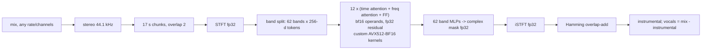

# turbo-roformer

**Real-time BS-RoFormer vocal separation on a CPU.**

A 4:12 song is split into vocals and instrumental in **3 minutes 5 seconds on an 8-core laptop chip** — no GPU,
2.4 GB of RAM, and the same output quality as the stock PyTorch model. That is a real-time factor of **0.73**
and **6.7× faster** than python-audio-separator running the same model on the same machine.

[](https://github.com/LoggeL/turbo-roformer/actions/workflows/ci.yml)
· MIT · Python ≥ 3.10 · Linux x86-64 (fast path) / anywhere PyTorch runs (portable path)
· [Deutsche Kurzfassung](docs/README.de.md)

| AMD Ryzen 7 8845HS (Zen 4, 8 cores), 4:12 song, overlap 2 | wall time | RTF | peak RAM | quality vs overlap-8 fp32 reference |
|---|---:|---:|---:|---:|
| python-audio-separator 0.47, stock fp32 | 20:32 | 4.88 | 3.0 GB | 31.37 dB |
| **turbo-roformer 0.1, bf16 kernels (default)** | **3:05** | **0.73** | **2.4 GB** | **31.34 dB** |
| turbo-roformer, overlap 1.5 (faster) | 2:20 | 0.56 | 2.4 GB | 29.61 dB |
| turbo-roformer, overlap 3 (better) | 4:34 | 1.09 | 2.4 GB | 33.28 dB |

RTF = wall time / song duration, model load (~1 s) excluded. The song is a commercial pop/worship track and is
not included; the reproducible synthetic benchmark and the full methodology are in
[docs/benchmarks.md](docs/benchmarks.md). The bf16 rounding error sits 53.6 dB below the signal (SNR vs the stock
output; 53.7 dB vs exact fp32), while chunked inference alone already leaves an error only ~31 dB below it (vs an
overlap-8 reference) — so bf16 adds a negligible error.

## Quickstart

```bash
pip install torch --index-url https://download.pytorch.org/whl/cpu      # CPU wheel, ~200 MB instead of ~2 GB
pip install "turbo-roformer @ git+https://github.com/LoggeL/turbo-roformer@v0.1.0"

turbo-roformer song.flac -o separated/
# model load 1.0 s (kernels, bf16, 8 threads)
#   chunk 1/29: 6.43 s
#   ...
# song.flac: duration 252.4 s | 29 chunks | wall 184.8 s | RTF 0.732
#   -> separated/song_instrumental.wav
#   -> separated/song_vocals.wav
```

The first run downloads the model (204 MB, sha256-verified) to `~/.cache/turbo-roformer` and, on a CPU with
AVX512-BF16, compiles the C++ kernels once (~10 s, needs `g++`). `turbo-roformer --info` shows what your machine
gets.

```python
from turbo_roformer import Separator

sep = Separator(model="resurrection", precision="bf16", threads=8)  # load once, reuse
inst = sep.separate(mix, sr=44100, overlap=2.0)  # float32 (channels, samples) or (samples,) -> (2, samples)
vocals = mix - inst  # for stereo input; see audio.to_stereo for other layouts

res = sep.separate_file("song.mp3", "out/", formats=("wav", "flac"))
print(res["instrumental"], res["rtf"])
```

`separate` accepts any channel count (mono is duplicated, 5.1 is downmixed with the centre kept) and any sample
rate (resampled to 44.1 kHz and back with soxr), calls `progress(k, n)` after every chunk, and raises
`ValueError` on NaN/inf or malformed input. CLI options: `--overlap`, `--precision bf16|fp32`, `--threads`,
`--backend auto|kernels|torch`, `--format wav|flac|mp3|ogg`, `--json`.

## How it works (short version)



Per 17-second chunk on the Ryzen 7 8845HS (from [`benchmarks/ladder.py`](benchmarks/ladder.py)):

```
stock reference forward, fp32 ......................... 36.0 s   (audio-separator's module: 40.3 s)
+ glibc malloc tuning (no mmap/page-fault churn) ...... 25.2 s   (31.4 s)
restructured forward (folded norms, fused qkv) fp32 ... 24.6 s   exact, 133 dB
+ bf16 GEMMs (oneDNN, fp32 accumulate) ................ 18.5 s
+ C++ glue kernels around torch bf16 SDPA ............. 12.8 s
+ custom AVX512-BF16 attention kernel .................  7.6 s
+ fused GEMM epilogues (rotary, residual, RMSNorm) ....  6.4 s   57-58 dB vs fp32
```

The big wins: the glibc allocator was page-faulting ~1 GB of fresh memory per layer; PyTorch's bf16 attention
runs at ~0.6 TFLOP/s on a CPU without AMX, while a hand-written `vdpbf16ps` kernel with an exact (non-online)
softmax reaches ~1.6 TFLOP/s on the same 4.4 TFLOP of time attention per chunk. The full story with profiles,
kernel design and numerics is in [docs/how-it-works.md](docs/how-it-works.md).

## Hardware

| CPU | what you get |
|---|---|
| Linux x86-64 **with AVX512_BF16**: AMD Zen 4 / Zen 5 (Ryzen 7000/8000/9000, EPYC 9004/9005), Intel Sapphire Rapids and newer Xeons | bf16 kernels (the numbers above were measured only on the Ryzen 7 8845HS) |
| other x86-64 (Intel client CPUs, Zen 3 and older, AVX-512 without BF16) | exact fp32 torch path: 3.9× slower per chunk than the kernels on the 8845HS (song RTF ≈ 2.9 there); other CPUs not measured |
| Apple Silicon, ARM64 Linux, Windows | exact fp32 torch path (tested on macOS arm64, not benchmarked for speed) |

Use one thread per physical core (`--threads`); SMT siblings do not help. On the 8845HS (60 s synthetic song): 4 threads
RTF 1.35, 6 threads 0.94, 8 threads 0.75, 16 threads 0.75.

## Limitations

- One `separate()` at a time per `Separator` (an internal lock serialises concurrent calls; buffers are reused).
  `threads` and the glibc malloc tuning are process-wide settings. Calls from worker threads work and use an
  allocation-free FF kernel (~3 % slower).
- On Linux, creating a `Separator` tunes glibc malloc for the whole process (no mmap for large blocks, 2 GB trim
  threshold), so the process RSS does not shrink after a separation. In long-lived services where that matters, set
  `TURBO_ROFORMER_NO_MALLOPT=1` (costs ~30 % speed) or run separation in a dedicated worker process.
- The fast path supports single-stem stereo BS-RoFormer checkpoints with 8 heads × 64; the fully fused kernels
  additionally need dim 256 (others fall back to the partially fused path). Only the "Instrumental Resurrection"
  model is in the registry and validated; other checkpoints load via `model=path, config=yaml` at your own risk.
- Clips shorter than one chunk (17 s) are zero-padded to the hop size; the model's output depends on its context,
  so a short clip separated alone differs slightly from the same audio inside a full song (as in audio-separator).
- Output quality is the model's, not ours: we reproduce python-audio-separator's inference (same chunk schedule,
  Hamming overlap-add, peak normalisation) bit-for-bit in fp32 and to ~54 dB in bf16.
- No GPU support (use the upstream projects for that).

## Development

```bash
pip install -e ".[dev]"
python -m pytest -q              # ~30 s, random small model, no download; kernel tests skip without AVX512-BF16
python -m pytest -q --weights    # + parity tests with the real weights (downloads 204 MB once)
python benchmarks/bench_synthetic.py --seconds 60
python benchmarks/ladder.py
```

On the reference machine the full suite with weights (and the optional `upstream` extra) is 127 tests in 74 s (30 s without weights). See [CONTRIBUTING.md](CONTRIBUTING.md).

## Roadmap

- Mel-band RoFormer models (a pre-release experiment, not in this repository, reached ~0.36 chunk RTF at ~61 dB
  vs fp32 on the same kernels; needs packaging and tests).
- More checkpoints in the registry (e.g. the vocals variant of Resurrection) with pinned checksums.
- Kernels for ARM (SVE/NEON bf16 dot products, Apple AMX) and AVX2-only x86.
- Processing several chunks concurrently on many-core servers; a streaming API.
- Prebuilt kernel wheels so no compiler is needed.

## Credits and licenses

- **Model**: "BS Roformer Instrumental Resurrection" by **unwa** —
  [huggingface.co/pcunwa/BS-Roformer-Resurrection](https://huggingface.co/pcunwa/BS-Roformer-Resurrection).
  Weights are downloaded from the author's upload (fallback: python-audio-separator's release mirror) and are
  **not** redistributed here; their terms are the author's.
- **Architecture**: Wei-Tsung Lu, Ju-Chiang Wang, Qiuqiang Kong, Yun-Ning Hung, *Music Source Separation with
  Band-Split RoPE Transformer* ([arXiv:2309.02612](https://arxiv.org/abs/2309.02612)).
- **Reference implementation**: [lucidrains/BS-RoFormer](https://github.com/lucidrains/BS-RoFormer) and
  [lucidrains/rotary-embedding-torch](https://github.com/lucidrains/rotary-embedding-torch) (MIT, Phil Wang).
- **Inference pipeline**: [nomadkaraoke/python-audio-separator](https://github.com/nomadkaraoke/python-audio-separator)
  (MIT, Andrew Beveridge) — chunking, overlap-add and normalisation are reproduced from it, and it is the baseline
  in every comparison. The config format follows ZFTurbo's Music-Source-Separation-Training.

turbo-roformer is MIT licensed (see [LICENSE](LICENSE)); upstream notices are in [NOTICE](NOTICE).
